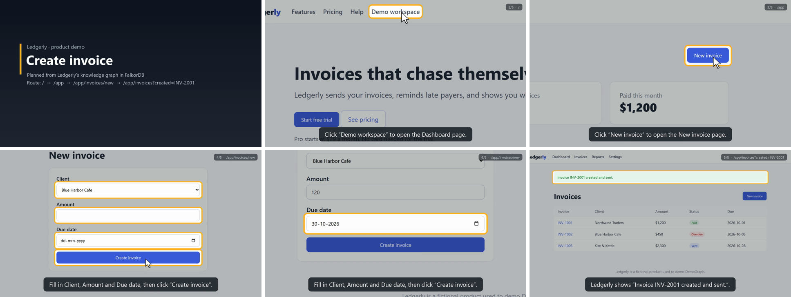
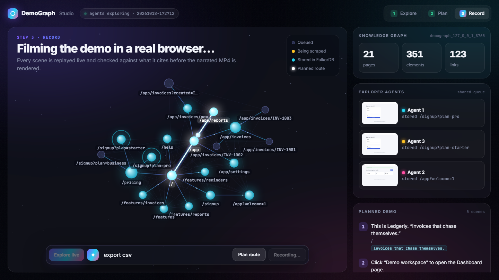
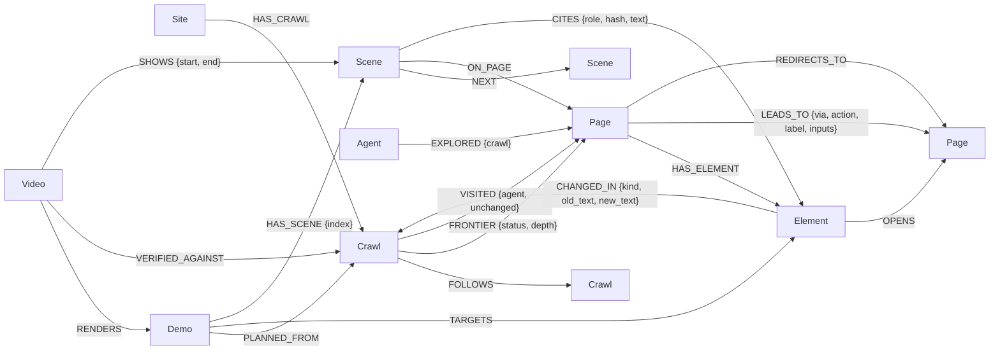

# DemoGraph

**A product's living knowledge graph, explored by browser agents and stored in FalkorDB, for making demo videos that stay accurate.**

Built for [Graph Hacks: Context for AI Agents](https://www.wemakedevs.org/hackathons/falkordb) (WeMakeDevs × FalkorDB, Oct 15–18, 2026).
Tracks: **01 Agents That Act on Connected Data** and **02 Agent Memory and Coordination**.

> Status: day 2. Explorer agents, the demo planner, the video recorder, and stale-scene detection work
> and are tested.

## Why a graph

Product demos go out of date the moment the product changes, and AI-made demos make things up. To avoid
both, an agent has to know three connected things:

- **how screens connect**: which click on which page leads where
- **what each screen says**: the prices, labels, and claims a video would repeat
- **what changed between releases**, and so which videos cited something that is no longer true

Those are relationships, so DemoGraph keeps them in FalkorDB and the agents read and write the graph on
every step. Without FalkorDB the Explorer has no work queue, no memory of earlier crawls, and no change
history. The graph is what the product runs on.

## What works today

- **Explorer agents** open the product in real Chromium (Playwright). They read every visible fact,
  follow links, click buttons, fill and submit forms with clearly fake data, and record what each action did.
- **Shared work queue in the graph.** Agents claim pages through `(:Crawl)-[:FRONTIER]->(:Page)` edges.
  FalkorDB runs write queries one at a time per graph, so a claim is atomic and no page is visited twice.
  More agents can join a running crawl from another process (`--join`).
- **Memory across sessions.** Each crawl remembers what every page said and what every button did. On the
  next crawl, unchanged pages are confirmed without rewriting, and buttons are not clicked again unless they
  or their form changed.
- **Crash-safe.** If a crawl is killed, `--resume` puts its unfinished pages back in the queue and carries on.
- **Change detection.** Every changed, added, or removed fact gets a `CHANGED_IN` edge to the crawl that
  saw it, with the old and new text.
- **Safe by default.** Buttons like *Delete*, *Pay*, *Cancel*, or *Log out* are never clicked. Clicking and
  form submission are only on for local apps (`localhost`, `*.test`) unless you pass `--interact`, and
  `robots.txt` is respected for public sites.
- **One graph per product** (`demograph_<host>_<port>`), using FalkorDB's multi-graph support.
- **Demo planner.** Ask for a feature in plain words (`"export csv"`, `"create an invoice"`). The planner
  finds the element with FalkorDB's full-text index, routes to it from the start page with weighted
  `algo.SPpaths` (a form submit costs more than a click, and links that no longer exist are never used),
  and turns every hop into a scene. Each scene **cites the exact elements** it shows or talks about, and a
  scene that mentions a number nothing it cites contains is rejected before saving.
- **Stale demos.** Each citation stores the element's content hash at planning time. After the next crawl,
  one query lists which scenes of which demos now show something different.
- **Recorder.** Replays a planned demo in real Chromium, checks that every cited element on the live page
  still says exactly what the scene cites, and renders a narrated 1280×720 MP4. Each scene eases the camera
  in on the elements it cites, rings them, puts a cursor on whatever gets clicked, and shows the narration as
  captions. Voiceover uses Microsoft Edge neural voices. The video's per-scene timeline goes into the graph,
  so after a release DemoGraph can say **which seconds of which video** are now wrong. It refuses to record
  a demo the graph marks stale or that the live product contradicts.

Measured on the included sample app (21 pages, 3 agents):

| Crawl | What happened | Pages unchanged | Clicks run | Clicks reused from graph |
|---|---|---|---|---|
| 1 | first crawl | 0 | 16 | 0 |
| 2 | nothing changed | 21 | 0 | 16 |
| 3 | Pro price $29→$35, "New invoice" renamed | 10 | 8 | 8 |

Crawl 3 reported exactly 11 changes, on the pages where the price or label appears:

```
CHANGED  /pricing        price   '$29' -> '$35'
CHANGED  /app/settings   price   '$29 a month' -> '$35 a month'
CHANGED  /app            button  'New invoice' -> 'Create an invoice'
CHANGED  /signup         input   'Plan: Starter · $9/month | Pro · $29/month | ...' -> '... Pro · $35/month ...'
...
```

### A planned demo

```
$ python -m demograph plan http://127.0.0.1:8765 "create an invoice"
Target   button “Create invoice” on /app/invoices/new  (full-text score 11, 5 reachable matches considered)
Route    cost 5 via algo.SPpaths over LEADS_TO
         / --link “Demo workspace”--> /app --click “New invoice”--> /app/invoices/new
           --submit “Create invoice”--> /app/invoices?created=INV-2001
Scenes
  0  intro     /                  This is Ledgerly. “Invoices that chase themselves.”
  1  navigate  /                  Click “Demo workspace” to open the Dashboard page.
  2  navigate  /app               Click “New invoice” to open the New invoice page.
  3  form      /app/invoices/new  Fill in Client, Amount and Due date, then click “Create invoice”.
  4  result    /app/invoices?...  Ledgerly shows “Invoice INV-2001 created and sent.”
Saved    demo-create-an-invoice-719b: 5 scenes, 8 citations -> graph + data/demos/demo-create-an-invoice-719b.json
```

Each scene also carries replayable browser steps (click, fill, select, with the expected URL after each
click) and a zoom box around what it cites, for the recorder.

After renaming the "New invoice" button and crawling again:

```
$ python -m demograph demos http://127.0.0.1:8765
  demo-change-plan-4e99              'change plan'            up to date
  demo-create-an-invoice-719b        'create an invoice'      1 of 5 scenes STALE
      scene 2 navigate  click 'New invoice' is now 'Create an invoice'
  demo-export-csv-97f3               'export csv'             up to date
```

### A rendered video

```
$ python -m demograph record http://127.0.0.1:8765 demo-create-an-invoice-719b
Voiceover for 5 scenes (en-US-AriaNeural)
Replaying the demo in Chromium and checking every citation on the live page
Rendering
Video    data/videos/demograph_127_0_0_1_8765/demo-create-an-invoice-719b/demo-create-an-invoice-719b.mp4  (31.6s)
           2.2s -   7.8s  demo-create-an-invoice-719b-s0
           7.8s -  12.5s  demo-create-an-invoice-719b-s1
          12.5s -  16.9s  demo-create-an-invoice-719b-s2
          16.9s -  22.6s  demo-create-an-invoice-719b-s3
          22.6s -  28.4s  demo-create-an-invoice-719b-s4
Graph    (:Video)-[:SHOWS {start, end}]-> 5 scenes, 8 citations verified live
```



The full video is [docs/proof-run/create-an-invoice.mp4](docs/proof-run/create-an-invoice.mp4) (31.6 s, with
voiceover and [captions](docs/proof-run/create-an-invoice.srt)). Every frame is a screenshot from the live
replay. Nothing is mocked up. Each recording also keeps the unedited browser session as `raw-session.webm`.

After the "Export CSV" button is renamed to "Download CSV" and the product is crawled again (a real run,
recorded with `--silent`):

```
$ python -m demograph demos http://127.0.0.1:8765
  demo-export-csv-9b33               'export csv'             2 of 5 scenes STALE  (1 video)
      scene 3 action    click 'Export CSV' is now 'Download CSV'
      scene 4 result    confirmation after clicking an element that is now 'Download CSV'

Video seconds that no longer match the product:
  .../demo-export-csv-9b33.mp4  13.8s-16.2s  scene 3: says “Export CSV”, the product now says “Download CSV”
  .../demo-export-csv-9b33.mp4  16.2s-21.3s  scene 4: shows what happens after clicking an element that now says “Download CSV”
```

The re-crawl that found this ran 1 click and reused 15 from graph memory.

### Live dashboard

```bash
.venv/Scripts/python -m demograph ui http://127.0.0.1:8765     # then open http://127.0.0.1:8800
```



A web page that reads FalkorDB every 0.6 s and animates the work as it happens:

- **Explore live:** pages appear in the graph as agents discover them. Each agent's dot moves to the page it is
  scraping, the page pulses while it is read, and it turns cyan once stored. Screenshots and the crawl log stream
  in the side panel.
- **Plan route:** the weighted shortest path to the feature glows on the graph, and the scenes and their
  citations are listed beside it.
- **Record video:** the narrated MP4 renders and plays in the panel. After a release, stale video seconds are
  listed in red.

## Graph data model



| Node | Key properties |
|---|---|
| `Site` | `id` (origin), `root_url` |
| `Crawl` | `id`, `status` (running/finalizing/completed), `max_pages`, `max_depth`, `interact`, `capped`, `clicks_run`, `clicks_reused` |
| `Page` | `id` (hash of normalized URL), `url`, `path`, `title`, `fingerprint`, `screenshot`, `gone` |
| `Element` | `id` = **fact id** (hash of URL + CSS selector), `selector`, `kind` (heading/text/price/link/button/input), `text`, `href`, `options`, `form`, `is_submit`, `bbox`, `content_hash`, `click_effect`, `click_target_url`, `click_note`, `click_inputs` |
| `Agent` | `id`, `kind` |
| `Demo` | `id`, `goal`, `path_cost`, `scenes`, `start_path`, `target_text` |
| `Scene` | `id`, `index`, `kind` (intro/navigate/form/action/result/highlight), `narration`, `steps` (JSON), `screenshot`, `zoom`, `page_title` |
| `Video` | `id`, `path`, `duration`, `voice`, `captions`, `raw_recording`, `verified`, `rendered_at` |

`LEADS_TO` edges also carry `cost` (1 for a link or click, 3 for a form submit, 1000 once stale) and
`stale`. `CITES.hash` is the element's content hash when the scene was planned.

**Drift = same fact id, new content hash.** The fact id says *which element*; the content hash says *what it
says now*.

Constraints and indexes ([demograph/schema.py](demograph/schema.py)): unique `id` on every node label, range
indexes on `Crawl.status`, `Page.path`, `Element.kind`, `[:FRONTIER].status`, `[:LEADS_TO].via`,
`[:CHANGED_IN].kind`, and a full-text index on `Element.text`.

## Cypher the product depends on

All queries live in [demograph/queries.py](demograph/queries.py). The planner's:

**Find the element a goal is about** (full-text index over everything the product says):

```cypher
CALL db.idx.fulltext.queryNodes('Element', $query) YIELD node, score
WITH node, score
WHERE NOT coalesce(node.removed, false)
MATCH (p:Page)-[:HAS_ELEMENT]->(node)
WHERE NOT coalesce(p.gone, false)
RETURN node.id, node.kind, node.text, p.id, p.path, node.is_submit, node.click_effect, node.click_note, score
ORDER BY score DESC LIMIT 25
```

**Cheapest route to it** (weighted shortest path; a route through a removed link costs 1000+ and is rejected):

```cypher
MATCH (a:Page {id: $start}), (b:Page {id: $target})
CALL algo.SPpaths({sourceNode: a, targetNode: b, relTypes: ['LEADS_TO'],
                   weightProp: 'cost', maxLen: $max_len, pathCount: 1})
YIELD path, pathWeight
RETURN [n IN nodes(path) | n.id],
       [r IN relationships(path) | {via: r.via, action: r.action, label: r.label, inputs: r.inputs, cost: r.cost}],
       pathWeight
ORDER BY pathWeight ASC LIMIT 1
```

**Which demos are stale** (a scene is stale when anything it cites now says something else):

```cypher
MATCH (d:Demo)-[:HAS_SCENE]->(s:Scene)-[c:CITES]->(e:Element)
WITH d, s, c.hash <> e.content_hash OR coalesce(e.removed, false) AS broken
WITH d, s, max(CASE WHEN broken THEN 1 ELSE 0 END) AS stale
RETURN d.id, d.goal, d.created_at, count(s) AS scenes, sum(stale) AS stale_scenes
```

**Which seconds of which videos are now wrong:**

```cypher
MATCH (v:Video)-[sh:SHOWS]->(s:Scene)-[c:CITES]->(e:Element)
WHERE c.hash <> e.content_hash OR coalesce(e.removed, false)
RETURN v.id, v.path, s.index, sh.start, sh.end, c.text, e.text, coalesce(e.removed, false)
ORDER BY v.id, sh.start
```

**Everything the recorder needs to replay a demo**, including each citation's current hash so a stale demo is
refused before the browser even starts:

```cypher
MATCH (:Demo {id: $demo_id})-[:HAS_SCENE]->(s:Scene)-[:ON_PAGE]->(p:Page)
OPTIONAL MATCH (s)-[c:CITES]->(e:Element)
WITH s, p, collect({fact_id: e.id, role: c.role, text: c.text, hash: c.hash, current: e.content_hash,
                    removed: coalesce(e.removed, false), selector: e.selector, kind: e.kind}) AS cites
RETURN s.id, s.index, s.kind, s.narration, s.steps, p.url, p.path, s.page_title, cites, p.title
ORDER BY s.index
```

**Retire links that disappeared** (run when a crawl finishes):

```cypher
MATCH (c:Crawl {id: $crawl_id})-[:VISITED]->(:Page)-[r:LEADS_TO]->()
WHERE r.crawl <> $crawl_id
SET r.stale = true, r.cost = $stale_cost
```

The Explorer's queries:

**Claim the next page from the shared frontier** (atomic, respects the page cap):

```cypher
MATCH (c:Crawl {id: $crawl_id, status: 'running'})
OPTIONAL MATCH (c)-[taken:FRONTIER]->()
WHERE taken.status IN ['claimed', 'done']
WITH c, count(taken) AS taken
WHERE taken < c.max_pages
MATCH (c)-[f:FRONTIER {status: 'pending'}]->(p:Page)
WITH f, p ORDER BY f.depth ASC, f.queued_at ASC LIMIT 1
SET f.status = 'claimed', f.agent = $agent_id, f.claimed_at = $now, f.attempts = f.attempts + 1
RETURN p.id, p.url, f.depth
```

**Record navigation and grow the frontier in one step:**

```cypher
UNWIND $links AS l
MATCH (src:Page {id: $page_id}), (c:Crawl {id: $crawl_id}), (via:Element {id: l.via})
MERGE (dst:Page {id: l.dst_id})
ON CREATE SET dst.url = l.dst_url, dst.path = l.dst_path, dst.first_seen = $now
MERGE (src)-[r:LEADS_TO {via: l.via}]->(dst)
SET r.action = l.action, r.label = l.label, r.inputs = l.inputs, r.crawl = $crawl_id, r.last_seen = $now
MERGE (via)-[:OPENS]->(dst)
MERGE (c)-[f:FRONTIER]->(dst)
ON CREATE SET f.status = CASE WHEN l.enqueue THEN 'pending' ELSE 'skipped' END,
              f.depth = l.depth, f.queued_at = $now, f.attempts = 0, f.from = $page_id
```

**Hand back work from an agent that died:**

```cypher
MATCH (:Crawl {id: $crawl_id})-[f:FRONTIER {status: 'claimed'}]->()
WHERE f.claimed_at < $stale_before
SET f.status = CASE WHEN f.attempts >= $max_attempts THEN 'failed' ELSE 'pending' END
RETURN count(f)
```

**What changed in a crawl:**

```cypher
MATCH (c:Crawl {id: $crawl_id})<-[ch:CHANGED_IN]-(x)
OPTIONAL MATCH (owner:Page)-[:HAS_ELEMENT]->(x)
RETURN ch.kind, coalesce(owner.path, x.path) AS page, x.kind, x.selector, ch.old_text, ch.new_text
```

**Pages that appeared or disappeared since the previous crawl:**

```cypher
MATCH (c:Crawl {id: $crawl_id})-[:FOLLOWS]->(prev:Crawl)
MATCH (prev)-[:VISITED]->(p:Page)
WHERE NOT (c)-[:VISITED]->(p)
CREATE (p)-[:CHANGED_IN {kind: 'page_removed', at: $now}]->(c)
```

## Run it locally

Requirements: Python 3.11+, and FalkorDB.

**1. Start FalkorDB**

With Docker (also starts FalkorDB Browser at http://localhost:3000):

```bash
docker compose up -d
```

Without Docker, on Windows with WSL (uses the server bundled in the `falkordblite` package):

```bash
wsl -d Ubuntu -- bash scripts/falkordb-wsl.sh
```

**2. Install**

```bash
python -m venv .venv
.venv/Scripts/python -m pip install -r requirements.txt   # macOS/Linux: .venv/bin/python
.venv/Scripts/python -m playwright install chromium
```

**3. Start the sample product** (Ledgerly, a fictional invoicing app with synthetic data)

```bash
.venv/Scripts/python sample_app/server.py --port 8765
```

**4. Explore it**

```bash
.venv/Scripts/python -m demograph explore http://127.0.0.1:8765 --agents 3
.venv/Scripts/python -m demograph status  http://127.0.0.1:8765
.venv/Scripts/python -m demograph map     http://127.0.0.1:8765
```

**5. Ship a "release" and see what changed**

```bash
.venv/Scripts/python sample_app/mutate.py price pro 35
.venv/Scripts/python sample_app/mutate.py label new_invoice "Create an invoice"
.venv/Scripts/python -m demograph explore http://127.0.0.1:8765 --agents 3
.venv/Scripts/python -m demograph changes http://127.0.0.1:8765
.venv/Scripts/python sample_app/mutate.py reset
```

**6. Plan demos and check them after releases**

```bash
.venv/Scripts/python -m demograph plan  http://127.0.0.1:8765 "export csv"
.venv/Scripts/python -m demograph plan  http://127.0.0.1:8765 "create an invoice"
.venv/Scripts/python -m demograph plan  http://127.0.0.1:8765 "export csv" --start /pricing --dry-run
.venv/Scripts/python -m demograph demos http://127.0.0.1:8765
```

Saved plans are also written to `data/demos/<demo-id>.json`.

**7. Record narrated videos**

```bash
.venv/Scripts/python -m demograph record http://127.0.0.1:8765 demo-export-csv-97f3   # a saved demo
.venv/Scripts/python -m demograph record http://127.0.0.1:8765 "change plan"          # plan + record in one go
.venv/Scripts/python -m demograph record http://127.0.0.1:8765 "export csv" --silent  # captions only, no network
```

Videos, captions, a poster frame, and the raw browser session go to
`data/videos/<graph>/<demo-id>/`. ffmpeg comes from your PATH, or from the bundled `imageio-ffmpeg`
binary. The voiceover sends only the narration text to Microsoft's Edge text-to-speech service. Use
`--silent` to keep everything local, or `--voice en-GB-SoniaNeural` to pick another voice.

Other explore options: `--resume` (continue a killed crawl), `--join <crawl-id>` (add agents from another
terminal), `--max-pages`, `--max-depth`, `--headed` (watch the browsers), `--interact/--no-interact`.

**Tests** (need FalkorDB running):

```bash
.venv/Scripts/python -m pytest
```

They cover a full crawl, memory reuse, change detection, crash-and-resume, the page cap, planning
feature and form demos, custom start pages, rejecting unsupported numbers, stale-scene detection, never
routing through removed links, rendering a verified video (codec, timeline, captions, graph timeline),
refusing stale or contradicted demos, and pinpointing the stale seconds of a video after a release. Each
runs against its own throwaway graph (voiceover is silent in tests, so no network is needed).

## Project layout

```
demograph/
  queries.py          every Cypher query
  schema.py           constraints and indexes
  ids.py              URL normalization, page ids, fact ids, content hashes
  db.py               async FalkorDB wrapper
  planner.py          goal -> target element -> shortest route -> cited scenes; save and verify
  recorder/
    __init__.py       graph check -> voiceover -> live replay -> render -> Video node
    replay.py         replays steps in Chromium, checks citations live, captures keyframes
    render.py         camera moves, rings, cursor, captions, title/closing cards, MP4 via ffmpeg
    media.py          Edge TTS voiceover (cached), WAV timeline, ffmpeg lookup
  explorer/
    extract.py        what is read from a page; safety rules; fake form values
    agent.py          one Explorer agent: claim, visit, diff, click, write
    crawl.py          start / join / resume a crawl, run agents, finalize
  __main__.py         CLI
sample_app/           Ledgerly sample product + mutate.py to simulate releases
docs/proof-run/       a rendered demo video, its captions, and a frame sheet
docs/animation/       3D explainer animation (Gemini-generated, edited) + MP4 capture script
demograph/ui/         live dashboard: server.py + animated index.html
tests/                end-to-end tests against a real FalkorDB
```

## Data

The crawled product is the bundled sample app, Ledgerly. Its content and invoices are synthetic. No
private, personal, or login-protected data goes into the graph.

## Prior work and AI disclosure

DemoGraph continues an idea from the author's earlier project
[Veridemo](https://github.com/Ariya-rithvik/demo): demo videos whose claims trace back to real page elements.
All code in this repository, including the FalkorDB graph model, the queries, and the Explorer, was
written during the hackathon.

This project was built with help from AI tools, disclosed as the rules require:

- **Claude Code** (AI coding assistant) helped write and test the code.
- **Google Gemini** generated the first version of the 3D explainer animation
  ([docs/animation/explainer.html](docs/animation/explainer.html)). It was then edited to show the real
  Ledgerly content and accurate claims, and given a frame-by-frame capture mode
  ([docs/animation/capture.py](docs/animation/capture.py)).

The author chose the idea and direction (it continues their Veridemo work), reviewed and tested everything,
and is responsible for the code.
