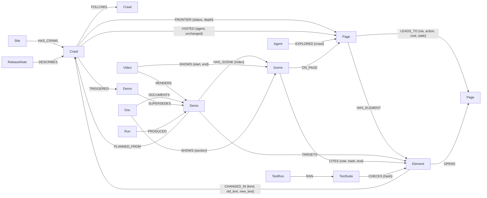

# DemoGraph

**Product demos, guides, tests and release notes that keep themselves true, built on a FalkorDB knowledge graph.**

DemoGraph sends browser agents through a web product, stores everything they see in FalkorDB, and uses that
graph to produce narrated demo videos, step-by-step guides, Playwright tests and release notes. Every sentence
in a video or guide cites the page element it is about. When the product changes, the graph shows exactly which
artifacts are now wrong, down to the seconds of a video, and the watcher rebuilds them automatically.

Built for [Graph Hacks: Context for AI Agents](https://www.wemakedevs.org/hackathons/falkordb)
(WeMakeDevs × FalkorDB, October 15–18, 2026).

**Tracks:** 01 · Agents That Act on Connected Data &nbsp;·&nbsp; 02 · Agent Memory and Coordination

**Demo video:** [docs/submission/demograph_submission.mp4](docs/submission/demograph_submission.mp4) (2:52)


---

## Contents

1. [The problem](#the-problem)
2. [How it works](#how-it-works)
3. [The seven agents](#the-seven-agents)
4. [How a change is traced](#how-a-change-is-traced)
5. [Graph data model](#graph-data-model)
6. [Cypher the product depends on](#cypher-the-product-depends-on)
7. [Run it](#run-it)
8. [Live dashboard](#live-dashboard)
9. [Results](#results)
10. [Which websites it works on](#which-websites-it-works-on)
11. [Testing](#testing)
12. [Project layout](#project-layout)
13. [Data, safety and rules](#data-safety-and-rules)
14. [Prior work and AI disclosure](#prior-work-and-ai-disclosure)

---

## The problem

Product demo videos and guides go out of date as soon as the product changes. A button is renamed, a price
moves, and the video keeps showing the old one. Nobody re-watches every video after every release, and
AI-generated demos can describe things that were never there.

Avoiding both needs connected knowledge:

- **how screens connect**: which click on which page leads where
- **what each screen says**: the labels, prices and claims a video repeats
- **what changed between releases**, and which videos, guides and tests depended on it

These are relationships, so DemoGraph keeps them in a graph. FalkorDB is not a side store: the agents' work
queue, memory, search, route planning and change tracking all run on it. Take FalkorDB away and none of the
agents can work.

## How it works

```
                    ┌──────────────────────── Orchestrator ────────────────────────┐
                    │                                                               │
  web product ──▶ Explorer agents ──▶ Knowledge Graph ──▶ Demo ──▶ Documentation ──▶ QA ──▶ Release notes
  (real Chromium)   (shared queue)      (FalkorDB)      (video)     (guide)        (tests)   (what changed)
                                            ▲                                                  │
                                            └──────────── Watcher: re-crawl, rebuild ◀─────────┘
```

1. **Explore.** Several browser agents crawl the product in parallel. They read every visible element, follow
   links, click buttons and submit forms (with fake data, on apps you own) and record where each action leads.
2. **Remember.** Every page, element and link becomes a node or edge. Each new crawl is compared with the last
   one, and every difference is recorded with its old and new text.
3. **Plan.** Ask for a feature in plain words ("export csv"). Full-text search finds the element, and a weighted
   shortest path finds the route to it from the start page.
4. **Record and document.** The route is replayed in a real browser. Every cited element is checked on the live
   page first. The result is a narrated MP4 that zooms in on each cited element, and a matching step-by-step guide.
5. **Test.** Playwright regression tests (one per demo) and smoke tests (one per page) are generated from the
   graph and run.
6. **Watch.** On a schedule, the product is re-crawled. When something changed, every affected demo is rebuilt:
   new route, new video, new guide, new tests, and release notes describing it all.

## The seven agents

Each agent reads what the previous one wrote to the graph. The dashboard's **agent pipeline** shows these
handoffs live.

| # | Agent | Input | Output (written to FalkorDB) | Command |
|---|---|---|---|---|
| 1 | **Orchestrator** | a site and a list of goals | runs agents 2–7 in order; a failing goal is reported and skipped. `(:Run)-[:PRODUCED]->(:Demo)` | `run` |
| 2 | **Explorer** | a start URL | pages, elements and links. Agents claim pages from a shared `(:Crawl)-[:FRONTIER]->(:Page)` queue, so no page is read twice | `explore` |
| 3 | **Knowledge Graph** | each page the Explorer reads | the diff against the last crawl (`CHANGED_IN {old_text, new_text}`), click memory (known buttons are not clicked again), retired links (`LEADS_TO.stale`) | part of `explore` |
| 4 | **Demo** | a goal in plain words | a route (full-text search plus `algo.SPpaths`), scenes that cite elements (`(:Scene)-[:CITES {hash}]->(:Element)`), and a narrated, captioned MP4 with its timeline (`(:Video)-[:SHOWS {start, end}]->(:Scene)`) | `plan`, `record` |
| 5 | **Documentation** | the Demo agent's verified replay | `guide.md` and `guide.html` with annotated screenshots, one step per scene. `(:Doc)-[:SHOWS {section}]->(:Scene)` | `document` (and every `record`) |
| 6 | **QA** | demos and the latest crawl | runnable pytest files (regression and smoke), linked to every element they assert. `(:TestSuite)-[:CHECKS {hash}]->(:Element)`, `(:TestRun)` | `qa` |
| 7 | **Release Intelligence** | a crawl and the one before it | release notes: what changed on which page, and which demos, videos, guides and tests it affected. `(:ReleaseNote)-[:DESCRIBES]->(:Crawl)` | `release` |

The **watcher** (`watch`) runs the loop after a release. It rebuilds each stale demo **locked onto the same
element by its fact id**, so a renamed button is still recognised as the same button. Then it re-records the
video and guide, regenerates the tests and writes release notes. It also:

- keeps one current demo per goal and retires duplicates;
- marks a demo **broken** when the element it showed no longer exists, instead of re-targeting it to some other text;
- finishes any rebuild that was interrupted;
- records history in the graph: `(:Demo new)-[:SUPERSEDES]->(:Demo old)` and `(:Crawl)-[:TRIGGERED]->(:Demo new)`.

## How a change is traced

Every element has two identifiers:

- **fact id**: a hash of the page URL and the element's CSS selector. It says *which element*.
- **content hash**: a hash of what the element says right now. It says *what it says*.

A scene stores the content hash of each element it cites when it is planned. After a release:

```
Element "Export CSV"  ──CHANGED_IN {old: "Export CSV", new: "Download CSV"}──▶  Crawl #N
        ▲
        │ CITES {hash: old}                      (hash no longer matches)
Scene 3 "Click “Export CSV”."
        ▲
        │ SHOWS {start: 17.5, end: 20.9}
Video demo-export-csv.mp4                    ⇒  seconds 17.5–20.9 are wrong
Doc guide.html, step 4                       ⇒  this step is wrong
TestSuite test_demo_export_csv.py            ⇒  this test will fail
```

```
$ python -m demograph demos http://127.0.0.1:8765
  demo-export-csv-9b33   'export csv'   2 of 5 scenes STALE  (1 video)
      scene 3 action    click 'Export CSV' is now 'Download CSV'
      scene 4 result    confirmation after clicking an element that is now 'Download CSV'

Video seconds that no longer match the product:
  .../demo-export-csv-9b33.mp4  13.8s-16.2s  scene 3: says “Export CSV”, the product now says “Download CSV”
```

## Graph data model



| Node | Key properties |
|---|---|
| `Site` | `id` (origin), `root_url` |
| `Crawl` | `id`, `status` (running / finalizing / completed), `max_pages`, `max_depth`, `capped`, `clicks_run`, `clicks_reused` |
| `Page` | `id` (hash of the normalized URL), `url`, `path`, `title`, `fingerprint`, `screenshot`, `gone` |
| `Element` | `id` = fact id, `selector`, `kind` (heading/text/price/link/button/input), `text`, `href`, `bbox`, `content_hash`, `click_effect`, `click_note` |
| `Agent` | `id`, `kind` |
| `Demo` | `id`, `goal`, `status` (current / superseded / broken), `path_cost`, `target_text` |
| `Scene` | `index`, `kind` (intro/navigate/form/action/result/highlight), `narration`, `steps` (JSON), `zoom` |
| `Video` | `path`, `duration`, `voice`, `captions`, `raw_recording` |
| `Doc` | `path` (Markdown), `html`, `title` |
| `TestSuite` / `TestRun` | `kind` (regression/smoke), `path`, `tests` / `passed`, `failed`, `failures` |
| `ReleaseNote` | `summary`, `changes`, `path` |
| `Run` | `goals`, `status`, `report` |

`LEADS_TO.cost` is 1 for a link or click, 3 for a form submit, and 1000 once the link has disappeared, so the
planner never routes through it. One graph per product (`demograph_<host>_<port>`) uses FalkorDB's
multi-graph support. Unique constraints exist on every node id, with range indexes on frontier status, page
path, element kind and change kind, and a full-text index on `Element.text`
([demograph/schema.py](demograph/schema.py)).

## Cypher the product depends on

All queries live in [demograph/queries.py](demograph/queries.py). The snippets below are generated from that
file.

**Explorer: claim the next page from the shared queue.** Writes run one at a time per graph in FalkorDB, so
this match-then-set is atomic and two agents can never claim the same page.

```cypher
MATCH (c:Crawl {id: $crawl_id, status: 'running'})
OPTIONAL MATCH (c)-[taken:FRONTIER]->()
WHERE taken.status IN ['claimed', 'done']
WITH c, count(taken) AS taken
WHERE taken < c.max_pages
MATCH (c)-[f:FRONTIER {status: 'pending'}]->(p:Page)
WITH f, p
ORDER BY f.depth ASC, f.queued_at ASC
LIMIT 1
SET f.status = 'claimed', f.agent = $agent_id, f.claimed_at = $now, f.attempts = f.attempts + 1
RETURN p.id, p.url, f.depth
```

**Explorer: record navigation and grow the queue in one step.**

```cypher
UNWIND $links AS l
MATCH (src:Page {id: $page_id}), (c:Crawl {id: $crawl_id}), (via:Element {id: l.via})
MERGE (dst:Page {id: l.dst_id})
ON CREATE SET dst.url = l.dst_url, dst.path = l.dst_path, dst.first_seen = $now
MERGE (src)-[r:LEADS_TO {via: l.via}]->(dst)
SET r.action = l.action, r.label = l.label, r.inputs = l.inputs, r.crawl = $crawl_id, r.last_seen = $now,
    r.cost = CASE l.action WHEN 'submit' THEN 3 ELSE 1 END, r.stale = false
MERGE (via)-[:OPENS]->(dst)
MERGE (c)-[f:FRONTIER]->(dst)
ON CREATE SET f.status = CASE WHEN l.enqueue THEN 'pending' ELSE 'skipped' END,
              f.depth = l.depth, f.queued_at = $now, f.attempts = 0, f.from = $page_id
```

**Demo: find the element a goal is about** (full-text index over everything the product says).

```cypher
CALL db.idx.fulltext.queryNodes('Element', $query) YIELD node, score
WITH node, score
WHERE NOT coalesce(node.removed, false)
MATCH (p:Page)-[:HAS_ELEMENT]->(node)
WHERE NOT coalesce(p.gone, false)
RETURN node.id, node.kind, node.text, p.id, p.path, node.is_submit, node.click_effect, node.click_note, score
ORDER BY score DESC
LIMIT 25
```

**Demo: the cheapest route to it** (weighted shortest path; a route through a removed link costs 1000+ and is
rejected).

```cypher
MATCH (a:Page {id: $start}), (b:Page {id: $target})
CALL algo.SPpaths({sourceNode: a, targetNode: b, relTypes: ['LEADS_TO'],
                   weightProp: 'cost', maxLen: $max_len, pathCount: 1})
YIELD path, pathWeight
RETURN [n IN nodes(path) | n.id],
       [r IN relationships(path) | {via: r.via, action: r.action, label: r.label, inputs: r.inputs, cost: r.cost}],
       pathWeight
ORDER BY pathWeight ASC
LIMIT 1
```

**Which demos are stale.**

```cypher
MATCH (d:Demo)-[:HAS_SCENE]->(s:Scene)-[c:CITES]->(e:Element)
WITH d, s, c.hash <> e.content_hash OR coalesce(e.removed, false) AS broken
WITH d, s, max(CASE WHEN broken THEN 1 ELSE 0 END) AS stale
RETURN d.id, d.goal, d.created_at, count(s) AS scenes, sum(stale) AS stale_scenes, coalesce(d.status, 'current')
ORDER BY d.created_at DESC
```

**Which seconds of which videos are now wrong.**

```cypher
MATCH (v:Video)-[:RENDERS]->(d:Demo), (v)-[sh:SHOWS]->(s:Scene)-[c:CITES]->(e:Element)
WHERE coalesce(d.status, 'current') <> 'superseded' AND (c.hash <> e.content_hash OR coalesce(e.removed, false))
RETURN v.id, v.path, s.index, sh.start, sh.end, c.text, e.text, coalesce(e.removed, false), c.role
ORDER BY v.id, sh.start
```

**Watcher: replace a stale demo with its rebuild.**

```cypher
MATCH (old:Demo {id: $old_id}), (new:Demo {id: $new_id}), (c:Crawl {id: $crawl_id})
SET old.status = 'superseded', old.superseded_at = $now, new.status = 'current'
MERGE (new)-[:SUPERSEDES]->(old)
MERGE (c)-[:TRIGGERED]->(new)
```

**Watcher: rebuilds that were interrupted** (along the whole version history).

```cypher
MATCH (n:Demo {status: 'current'})-[:SUPERSEDES*1..]->(o:Demo)
WHERE NOT (:Video)-[:RENDERS]->(n) AND ((:Video)-[:RENDERS]->(o) OR (:Doc)-[:DOCUMENTS]->(o))
RETURN DISTINCT n.id, n.goal
```

**QA: tests that will fail because the product changed.**

```cypher
MATCH (t:TestSuite)-[ch:CHECKS]->(e:Element)
WHERE NOT coalesce(t.superseded, false) AND (ch.hash <> e.content_hash OR coalesce(e.removed, false))
RETURN t.id, t.kind, t.path, count(e)
```

**Knowledge Graph: retire links that disappeared** (run when a crawl finishes).

```cypher
MATCH (c:Crawl {id: $crawl_id})-[:VISITED]->(:Page)-[r:LEADS_TO]->()
WHERE r.crawl <> $crawl_id
SET r.stale = true, r.cost = $stale_cost
RETURN count(r)
```

## Run it

Requirements: Python 3.11+ and FalkorDB. ffmpeg is used from your PATH, or from the bundled `imageio-ffmpeg`.

**1. Start FalkorDB.** With Docker (this also starts FalkorDB Browser at http://localhost:3000):

```bash
docker compose up -d
```

Without Docker, on Windows with WSL (uses the FalkorDB server bundled in the `falkordblite` package):

```bash
wsl -d Ubuntu -- bash scripts/falkordb-wsl.sh
```

**2. Install.**

```bash
python -m venv .venv
.venv/Scripts/python -m pip install -r requirements.txt     # macOS/Linux: .venv/bin/python
.venv/Scripts/python -m playwright install chromium
```

**3. Start the sample product**, Ledgerly: a fictional invoicing app with synthetic data.

```bash
.venv/Scripts/python sample_app/server.py --port 8765
```

**4. Everything in one command** (Orchestrator):

```bash
.venv/Scripts/python -m demograph run http://127.0.0.1:8765 "export csv" "create an invoice"
```

**Or step by step:**

```bash
.venv/Scripts/python -m demograph explore  http://127.0.0.1:8765 --agents 3      # Explorer + Knowledge Graph
.venv/Scripts/python -m demograph plan     http://127.0.0.1:8765 "export csv"    # Demo: route + scenes
.venv/Scripts/python -m demograph record   http://127.0.0.1:8765 "export csv"    # Demo + Documentation
.venv/Scripts/python -m demograph qa       http://127.0.0.1:8765                 # QA
.venv/Scripts/python -m demograph release  http://127.0.0.1:8765                 # Release Intelligence
.venv/Scripts/python -m demograph demos    http://127.0.0.1:8765                 # what is stale, and where
```

**Ship a release and watch it rebuild:**

```bash
.venv/Scripts/python sample_app/mutate.py label export_csv "Download CSV"
.venv/Scripts/python -m demograph watch http://127.0.0.1:8765 --every 60
.venv/Scripts/python sample_app/mutate.py reset
```

Useful options: `--resume` (continue a killed crawl), `--join <crawl-id>` (add agents from another terminal),
`--max-pages`, `--max-depth`, `--headed` (watch the browsers), `--silent` (no voiceover, nothing sent to the
network), `--voice en-GB-SoniaNeural`. Outputs go to `data/videos/`, `data/docs/`, `data/qa/` and
`data/releases/`.

## Live dashboard

```bash
.venv/Scripts/python -m demograph ui http://127.0.0.1:8765        # then open http://127.0.0.1:8800
```

DemoGraph Studio reads FalkorDB every 0.7 seconds and shows the work as it happens:

- **Site box:** the website to work on.
- **Agent pipeline:** the seven agents and the output each one hands to the next; a moving packet marks a live handoff.
- **Explore live:** pages appear as agents discover them, each agent glides to the page it is reading, and stored pages turn indigo.
- **Replay exploration:** re-plays how the product was mapped, outward from the home page.
- **Plan route:** the shortest path to the feature lights up, with the scenes and their citations.
- **Record video + guide:** renders the MP4 and the guide, which then play and open in the inspector.
- **Simulate release** (sample app only) and **Watch for changes:** the changed page turns red, the change travels to
  the demo, its video and guide, and the watcher rebuilds them.

The dashboard only accepts commands from its own page; cross-site requests are refused.

## Results

Measured on the sample app (21 pages, 3 agents):

| Crawl | What happened | Pages unchanged | Clicks run | Clicks reused from graph memory |
|---|---|---|---|---|
| 1 | first crawl | 0 | 16 | 0 |
| 2 | nothing changed | 21 | 0 | 16 |
| 3 | Pro price $29 → $35, "New invoice" renamed | 10 | 8 | 8 |

- Crawl 3 reported exactly 11 changes, on the pages where the price or the label appears.
- After a button rename, the watcher detected the release and rebuilt the demo, video and guide on its own. The
  generated regression test failed with the exact reason (`live page says "Export CSV", scene cites "Download CSV"`)
  until it was regenerated.
- The Orchestrator ran explore, two recorded demos, 23 generated tests (all passing) and a run report in one
  command, and reported an impossible goal ("teleport to mars") without stopping the run.
- On a real public site, [books.toscrape.com](https://books.toscrape.com) (a sandbox made for scraping practice), it
  crawled 15 pages in 25 seconds and produced a narrated, verified demo and guide.

Sample outputs: [a rendered demo video](docs/proof-run/create-an-invoice.mp4) with
[captions](docs/proof-run/create-an-invoice.srt), and a [3D explainer](docs/animation/explainer.mp4).

## Which websites it works on

| Website | What DemoGraph does |
|---|---|
| **Your own app** (localhost or `*.test`) | Everything: follows links, clicks buttons, submits forms with obviously fake data, records, documents, tests, watches |
| **Public sites that allow crawlers** | Follows links only (no clicks or form submits unless you pass `--interact`), then plans, records, documents and tests from links |
| **Sites whose robots.txt forbids bots** (for example zomato.com) | Refuses to crawl. This is deliberate. |
| **Pages behind a login, CAPTCHA or paywall** | Not supported; the hackathon rules also forbid loading such data |

Large sites are explored up to `--max-pages` (default 40) and `--max-depth` (default 5). Buttons such as
*Delete*, *Pay*, *Cancel* or *Log out* are never clicked.

## Testing

```bash
.venv/Scripts/python -m pytest
```

16 end-to-end tests run against a real FalkorDB. Each uses its own throwaway graph, and the voiceover is silent,
so no network is needed. They cover:

- **Explorer:** a full crawl, memory reuse, change detection, crash and resume, and the page cap.
- **Planner:** feature and form demos, custom start pages, rejecting numbers nothing cites, stale-scene detection,
  and never routing through removed links.
- **Recorder:** a verified video (codec, timeline, captions, graph timeline), refusing stale or contradicted demos,
  and pinpointing the stale seconds after a release.
- **Documentation and watcher:** writing a verified guide; rebuilding a stale demo with its video, guide, history
  edges and retired duplicates; and marking a demo broken when its feature is removed.

## Project layout

```
demograph/
  queries.py          every Cypher query
  schema.py           constraints and indexes
  ids.py              URL normalization, page ids, fact ids, content hashes
  db.py               async FalkorDB wrapper
  explorer/           Explorer + Knowledge Graph agents: extract.py, agent.py, crawl.py
  planner.py          Demo agent, planning: goal -> element -> shortest route -> cited scenes
  recorder/           Demo agent, filming: live replay, rendering, voiceover
  documenter.py       Documentation agent
  qa.py               QA agent
  release.py          Release Intelligence agent
  orchestrator.py     Orchestrator agent
  watcher.py          watch loop: re-crawl, rebuild stale demos, heal interrupted rebuilds
  ui/                 DemoGraph Studio dashboard (server.py + index.html)
  __main__.py         command line
sample_app/           Ledgerly sample product + mutate.py to simulate releases
tests/                end-to-end tests against a real FalkorDB
docs/                 submission video, sample demo, 3D explainer, dashboard screenshot
scripts/              FalkorDB-in-WSL starter, README generator
```

## Data, safety and rules

- The product explored for the demo is Ledgerly, a bundled sample app with synthetic data. The public test used
  books.toscrape.com, a sandbox built for scraping practice.
- No private, personal or login-protected data goes into the graph. Forms are filled only on apps you own, and
  only with obviously fake values.
- `robots.txt` is respected, and dangerous buttons are never clicked.
- The voiceover sends only narration text to Microsoft's Edge text-to-speech service; `--silent` keeps
  everything local.

## Prior work and AI disclosure

DemoGraph continues an idea from the author's earlier project [Veridemo](https://github.com/Ariya-rithvik/demo):
demo videos whose claims trace back to real page elements. All code in this repository, including the FalkorDB
graph model, the queries and all seven agents, was written during the hackathon.

AI tools used, disclosed as the rules require:

- **Claude Code** (AI coding assistant) helped write, review and test the code.
- **Google Gemini** generated the first version of the 3D explainer animation, which was then edited to show
  the real product and accurate claims.
- **Microsoft Edge neural text-to-speech** provides the voiceover.

The author chose the idea and direction, reviewed and tested the work, and is responsible for the code.
